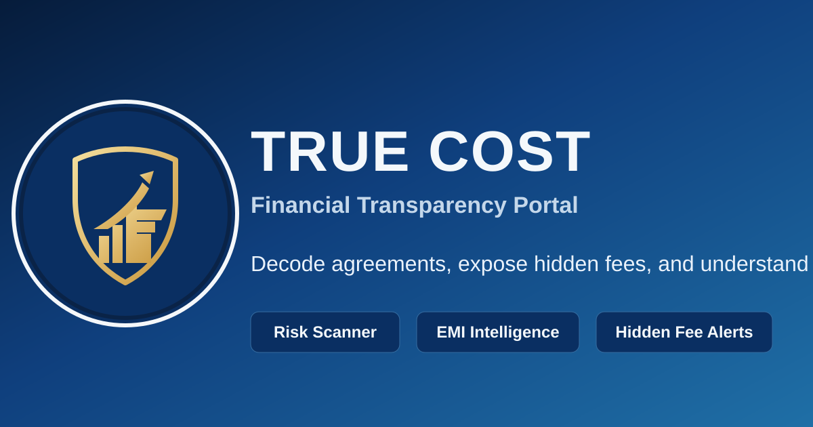

# TRUE COST

Financial clarity for real people. TRUE COST analyzes loan and credit terms, surfaces hidden fees, and shows the real repayment burden before you commit.


## What This Product Does

-  Decodes financial/legal text into plain-language risks
-  Detects hidden fees and manipulative clauses
-  Computes EMI, total payment, and true interest burden
-  Generates a risk score with optional AI recommendations
-  Supports INR and USD and other major currency extraction & calculations

## Visual Snapshot



## Core Experience

1. Paste agreement text on the Analyze page or upload image and pdf
2. Auto-extract amount, APR, and duration
3. Review hidden-fee flags, EMI math, and risk score
4. Explore worst-case scenarios and savings simulation
5. Compare alternatives before signing

## Run Locally

```bash
npm install
npm run dev -- --host 0.0.0.0 --port 5175
```

Open: http://localhost:5175

## OpenRouter Setup

The AI-enhanced analysis uses OpenRouter. Set this environment variable before running the app:

```bash
OPENROUTER_API_KEY=your_openrouter_api_key
```

The key is consumed by the server-side proxy and must not be exposed in browser code. For local development, set `OPENROUTER_API_KEY` in `.env.local`; on Netlify, add it in Site settings > Environment variables, then redeploy. The proxy also applies a bounded per-client request limit; set `OPENROUTER_RATE_LIMIT_MAX_REQUESTS` to change the per-minute limit for a deployment.

## Analysis rules

Detection is configured in `src/data/analysisRules.json`:

- `polarity` defines negators, clause scopes, waivers, conditions, and hypothetical language.
- `protectionCatalog` and `findingsUI` define positive terms and their shared explanation.
- `rateAttributes` separates fixed/variable/introductory types from flat/reducing calculation bases.
- `scenarioPeriods` defines the periods used by grace-window scenarios.
- `riskScoring` sets noisy-OR severity weights and score bands; catalog `minimumRiskBand` values set configured floors.
- `textNormalization`, `periodRoles`, `plausibility`, and `legalStructure` configure OCR repair, duration roles, conflicting amounts, and legal references.

The canonical findings list drives diagnosis, glossary, risk, and page panels. Optional OpenRouter insights receive structured facts with provenance and verified evidence; validation strips unsupported claims. AI output never changes financial calculations or risk scores.

## Limits and interpretation

- PDF imports are limited to 20 MB and 30 pages. Image imports are limited to 40 megapixels, and OCR runs locally in the browser.
- Pasted or extracted analysis text is limited to 250,000 characters to keep deterministic analysis bounded in the browser.
- Imported text is evidence for decision support, not legal or financial advice. Unresolved or ambiguous fields are surfaced instead of silently guessed.
- `netDisbursed` represents economic proceeds after documented upfront costs, including fees paid separately. APR and total-cost calculations use the same proceeds basis.
- AI assistance is optional and sends extracted text or verified analysis context to the configured provider through the server proxy. Provider availability, rate limits, and deployment quotas can affect generated insights.
- The development upload evaluation includes no held-out owner documents at present; its held-out section is therefore reported as not evaluated rather than as a measured accuracy result.

## Scripts

```bash
npm run dev
npm run build
npm run lint
npm run test
npm run typecheck
npm run evaluate
npm run evaluate:uploads
```

## Project Stack

- Frontend: React + TypeScript + Vite
- UI: Tailwind CSS + shadcn/ui + Framer Motion
- Logic: Local financial analysis engine (no mandatory backend)
- Testing: Vitest

## Brand Notes

TRUE COST is positioned as a trust-first financial intelligence interface:

- Clear signal over noise
- Explanations over jargon
- Defensive decision support over sales pressure
